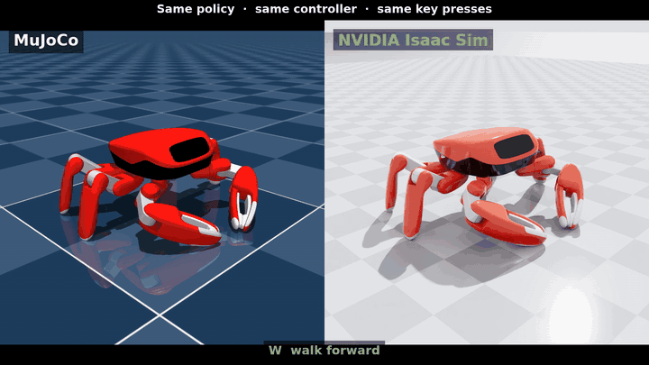

# Jumper in Isaac Sim

**A MuJoCo-trained walking policy, running in NVIDIA Isaac Sim with no retraining.**



[Jumper](https://github.com/KingKongRobotics/jumper) is an open-source crab robot by KingKong
Robotics, with policies trained in MuJoCo. This repository runs the same ONNX policy, through
Jumper's own controller, in Isaac Sim (PhysX), and checks that it walks the way it does in
MuJoCo.

Why: every physics engine models contact, friction and motors differently. A policy that only
works in the engine it was trained in has probably learned that engine's quirks. If it
behaves the same in a second engine, it is far more likely to be robust. This is simulation
only; nothing here has run on hardware.

## Results

The same scripted key presses (W, S, D, J, 5 s each) through the same controller in both
engines, averaged over the last 2 s of each key:

| | MuJoCo | Isaac Sim | Gap |
|---|---|---|---|
| Walk forward (W) | +0.756 m/s | +0.710 m/s | 6.1% |
| Walk back (S) | −0.742 m/s | −0.654 m/s | 11.9% |
| Step right (D) | −0.702 m/s | −0.671 m/s | 4.4% |
| Turn left (J) | +3.793 rad/s | +3.803 rad/s | 0.3% |
| Max tilt | 2.4° | 2.4° | |
| Standing height | 0.1026 m | 0.1072 m | +4.6 mm |

From a fresh `./bootstrap.sh` (Isaac Sim 5.1.0, headless, 1.24× real time). Before driving,
the check also confirms the asset itself: link masses within 3.5e-9 kg, joint limits within
5e-7 rad, every link's position within 0.0001 mm of MuJoCo's.

The robot stands 4.6 mm taller in Isaac Sim: MuJoCo contacts are soft, PhysX contacts are
rigid ([why that is left visible](docs/PORTING.md#not-reproduced-soft-contact)).

## Quick start

Needs Linux x86_64 with an NVIDIA RTX GPU and its driver, Python 3.12, and about 30 GB of
disk if Isaac Sim is not installed yet. Tested on Ubuntu 24.04, which ships Python 3.12;
Ubuntu 22.04 should work with Python 3.12 from the deadsnakes PPA, but has not been tested.

```bash
git clone https://github.com/sanket369/jumper-isaac-sim.git
cd jumper-isaac-sim

./bootstrap.sh                          # Isaac Sim 5.1 already in ~/isaacsim/...
./bootstrap.sh --isaac-sim /path/to/it  # ... or somewhere else
./bootstrap.sh --download-isaac-sim     # ... or not installed yet (~8.8 GB download)

./run_teleop.sh
```

`bootstrap.sh` clones Jumper at a pinned commit, builds its Python environment (CPU only),
adds onnxruntime to Isaac Sim's Python, exports the robot exactly as it was trained, builds
the USD, and finishes by driving the robot headless and comparing it with MuJoCo. It never
runs `sudo`: when something system-level is missing, it prints the command and stops. Run it
again at any time; finished steps are skipped.

`run_teleop.sh` opens Isaac Sim with the crab loaded. **Click the viewport**, then:

| Key | Does |
|---|---|
| W / S | walk forward / back |
| A / D | step left / right |
| J / L | turn left / right |
| Space | jump |
| C | camera follows the robot on / off |

All keys, including the dances, gestures and claw modes: [docs/CONTROLS.md](docs/CONTROLS.md).
`./run_teleop.sh --browser` only enables the example instead; open it from
**Window → Examples → Robotics Examples → Policy → Crab → LOAD**.

## Compare the two engines yourself

```bash
./scripts/sim2sim_check.sh                 # Isaac Sim headless vs the MuJoCo reference
./scripts/sim2sim_check.sh --mujoco        # re-run MuJoCo first
./scripts/sim2sim_check.sh --app           # also run the interactive example end to end
./scripts/sim2sim_check.sh --video clips/  # record both drives, same camera, same timing
```

It passes when every speed is within 20% of MuJoCo's and the robot stays upright, after first
checking the asset itself: masses, joint limits and every link's position against MuJoCo.

## How it works

The port keeps the robot, the contacts, the motors and the controller what the policy saw in
training: the compiled training model rather than the raw XML, 18 fixed joints for welded
parts, foot hulls reduced to PhysX's 255-vertex limit (≤ 0.6 mm), friction combine modes that
match MuJoCo's rule, the training servo curve applied every 1 ms instead of PhysX drives, and
Jumper's own `controller.so` building the observation. Details and measurements:
[docs/PORTING.md](docs/PORTING.md).

```
bootstrap.sh            install, build, check
run_teleop.sh           drive it in Isaac Sim
config/                 every pinned version (versions.env, jumper-constraints.txt)
exts/jumper.crab_example/
  jumper_crab/
    crab_core/          no Isaac imports: controller loop, servo, keys, scripted drive
    crab_isaac/         the articulation in a stage: state in, torque out
    example/            the interactive example (Examples > Policy > Crab)
tools/                  export_model, build_usd, mujoco_reference, isaac_check, ...
scripts/                sim2sim_check.sh, lib.sh
docs/                   PORTING.md, CONTROLS.md
osmo/                   coming soon: the same check, automated with NVIDIA OSMO
```

Generated files go to `data/` and Jumper to `third_party/jumper/`; neither is committed.
The Isaac Sim install is not modified apart from onnxruntime in its Python.

## Scope

- **Checked:** walking (Jumper's `locomotion` mode, policy `jumper.posture`) against MuJoCo.
- **Runs, not checked:** the other modes (jump, gestures, dances, claw).
- **Tested on:** Ubuntu 24.04, Isaac Sim 5.1.0, RTX PRO 5000 Blackwell laptop GPU, driver
  580.178.04.
- **Coming:** the [OSMO pipeline](osmo/README.md) with robustness sweeps.

## Credits

The robot, its policies and its controller are
[Jumper by KingKong Robotics](https://github.com/KingKongRobotics/jumper) (Apache 2.0). The
Isaac Sim port and this repository are by Sanket Khade. See [NOTICE](NOTICE).

Licensed under the [Apache License 2.0](LICENSE).
